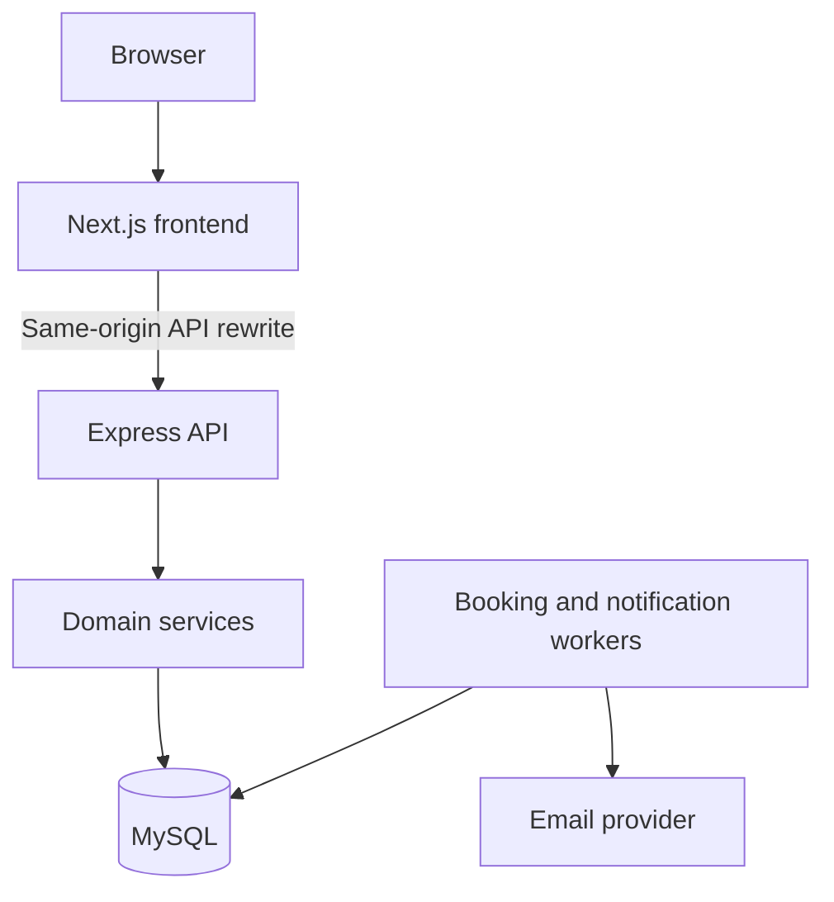
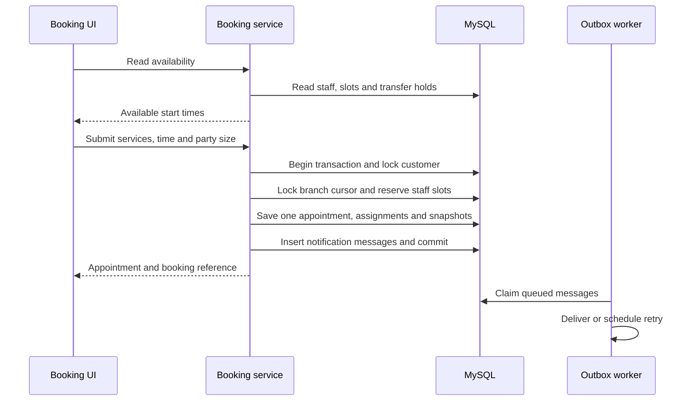

# Architecture

Serpente Nail Room consists of a Next.js web application, an Express API and a MySQL database. The frontend serves customer, staff and administrator interfaces from the same application.

## System boundaries

The browser calls `/api/...` on the frontend origin. [Next configuration](../frontend/next.config.ts) rewrites these paths to `NEXT_PUBLIC_API_BASE_URL`. Express mounts the business routes in [app.ts](../src/app.ts). `/health` is an API process endpoint outside the `/api` namespace.

## Code organization

| Layer | Entry points | Responsibility |
| --- | --- | --- |
| Pages and UI | `frontend/src/app`, `frontend/src/components` | Rendering, forms and interaction |
| API and session client | [api.ts](../frontend/src/lib/api.ts), [auth.ts](../frontend/src/lib/auth.ts) | Response types, access tokens, session restoration and pagination |
| Frontend security | [proxy.ts](../frontend/src/proxy.ts) | Per-request CSP nonce |
| API startup | [server.ts](../src/server.ts) | Database initialization, migration guard, workers and graceful shutdown |
| Middleware | `src/common/middleware` | JWT authentication, role gates, origin validation, rate limits and audit |
| Domain modules | `src/modules` | Routes, request validation, controllers, services and entities |
| Persistence | [database.ts](../src/config/database.ts) | MySQL connection, entity registration and migration discovery |
| Maintenance job | [retention-cleanup.ts](../src/jobs/retention-cleanup.ts) | Explicitly invoked retention cleanup |

Modules cover accounts, branches, staff, services/categories, appointments, walk-ins, promotions, site content, media, traffic and audit events. Appointment operations include allocation, pricing, transfers, assistance and notification delivery.

## Booking transaction

The availability response is advisory. Allocation is repeated when writing, inside a `READ COMMITTED` transaction. A branch cursor lock protects ranking and rotation; the staff-slot primary key protects ordinary reservation uniqueness. A group succeeds only if all required primary employees can be allocated.

One appointment stores the party. Assignment rows store the workers and per-worker progress. Service snapshots are stored once per appointment; pricing accounts for party size and actual-price overrides. See [Booking](BOOKING.md).

## Account and authorization flow

All three account roles use email OTP on an untrusted browser. Successful authentication issues a short-lived JWT and a refresh session. Browser trust is scoped to the account. Refresh requests rotate server-side sessions; the frontend keeps access tokens in memory.

Role gates are hierarchical: STAFF can use customer routes and ADMIN can use staff/customer routes. Domain services still enforce ownership, selected-worker requirements and special restrictions such as recipient-only transfer acceptance. See [Authentication](AUTH-SECURITY.md).

## Background work

The API starts two in-process workers after the database and production migration checks:

- Notification delivery: immediately and approximately every 60 seconds; claims persisted outbox messages and retries delivery failures.
- Booking operations: immediately and every 30 seconds; expires transfer requests and reconciles overdue pending/confirmed appointments to `no_show`.

The retention cleanup script is separate; `server.ts` does not schedule it. Hosting schedules must invoke it explicitly. See [Operations](OPERATIONS.md).

## Time and integration boundaries

Appointment timestamps are UTC; business dates and daily/monthly summaries use Vietnam time. Branch opening hours and recurring staff hours constrain ordinary booking. Availability also considers logical transfer holds, which are distinct from physical 15-minute reservations.

Email provider calls are outside the booking transaction. OTP delivery is synchronous; booking notifications use the outbox. Uploaded image bytes use the existing MySQL connection. The application records prices and revenue summaries without processing online payments.
