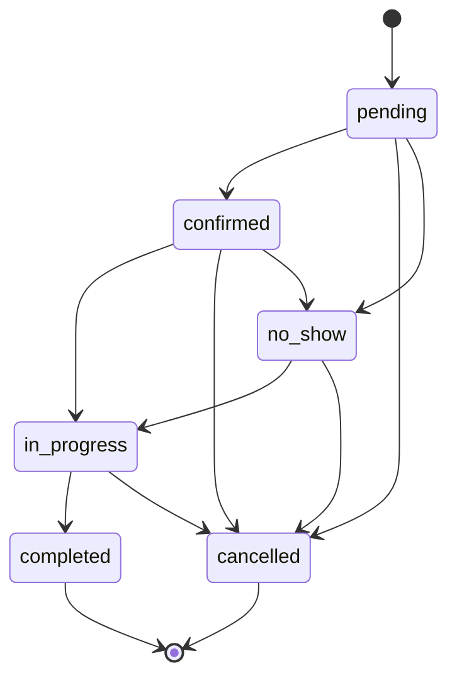

# Booking and staff operations

This page describes scheduling and work ownership. Request schemas and routes are listed in the [API reference](API.md); the persistence model is covered in [Database](DATABASE.md).

## Customer booking

A signed-in CUSTOMER, STAFF or ADMIN can make a personal booking. The API derives the customer from the authenticated account and rejects `user_id`, `customer_email` or `staff_id` overrides on the public create endpoint.

The client selects services from one branch, party size, date and a returned start time. Services must be enabled for booking and have a configured duration. Every guest receives the selected service sequence; duration is the sum of service durations, and the reference charge is the sum of snapshot prices multiplied by party size.

A successful request creates **one appointment for the entire party**, with one primary employee assignment per guest. The response is that appointment, including assignments and service snapshots. `booking_group_id` supplies the customer-facing reference; it does not split new bookings into separate appointment records.

## Time and availability

| Rule | Behavior |
| --- | --- |
| Business timezone | `Asia/Ho_Chi_Minh`; timestamps stored as UTC |
| Branch hours | Parsed from `branches.opening_hours`, not a global fixed schedule |
| Opening-hours format | Same-day increasing `HH:mm-HH:mm` interval on 15-minute boundaries; a missing schedule makes the branch unbookable |
| Employee hours | Recurring daily `work_start_time` and `work_end_time` |
| Start-time grid | 15 minutes; seconds and milliseconds must be zero |
| Customer booking window | At least 3 hours ahead, at most 14 days ahead |
| Pending limit | At most 3 distinct pending booking references per customer |
| Ordinary reservation interval | `[start_time, end_time)` with no before/after buffer |

Availability is calculated from staff working hours, physical `staff_booking_slots` and active transfer holds. It returns starts with enough employees free for the full requested duration. The `date` query must represent midnight in Vietnam time.

Availability is an estimate at read time, not a hold. The server allocates capacity again when the booking is submitted. Staff-hour changes are checked against existing future work by the staff service.

Sources: [opening-hours parser](../src/modules/branches/branch-opening-hours.ts), [booking service](../src/modules/appointments/appointments.service.ts), [staff service](../src/modules/staffs/staffs.service.ts).

## Allocation and transaction boundaries

Ordinary creation uses a `READ COMMITTED` TypeORM transaction:

1. Lock the customer row and enforce the pending-booking limit.
2. Lock the branch's `staff_assignment_rotation` cursor row.
3. Check current staff records and full-interval working hours.
4. Rank available employees and reserve every required 15-minute slot.
5. Save one appointment, its primary assignments, service snapshots and notification outbox entries.
6. Commit only when the entire party is allocated.

The staff-slot composite primary key `(staff_id, slot_start)` prevents two ordinary reservations from occupying the same employee interval. A duplicate insert can cause another candidate to be tried. Insufficient capacity raises `409 SLOT_UNAVAILABLE` and rolls back the transaction.

The automatic ranking uses:

```text
score = 0.6 * daily_assigned_minutes / shift_minutes
      + 0.4 * trailing_14_day_assigned_minutes / (14 * shift_minutes)
```

Candidates within 0.05 of the lowest score use a rotating roster tie-break. The window includes the booking day and preceding 13 days. Selection considers recorded assignment workload, not skill specialization. See [staff-allocation.ts](../src/modules/appointments/staff-allocation.ts).

## Booking identity and lookup

The display reference is `(booking_group_id ?? id).slice(0, 8).toUpperCase()`. It is a short lookup key, not a globally unique credential.

Admin list search accepts a 1-8 hexadecimal character prefix. Reception lookup requires a complete eight-character reference or valid phone number, returns at most ten matches, and limits STAFF to their branch. Lookup does not grant ownership or permission to start someone else's work.

## Appointment and assignment lifecycle



- Confirmation checks that the branch exists and assignment count matches party size.
- Starting an employee's work sets that assignment's `started_at`. The first start also records appointment-level `actual_started_at`.
- Starting before the scheduled time requires `early_start_confirmed=true`, an explicit attestation that customer and employee are ready. It is not an independently observed presence check.
- Another employee may start their assignment while the shared booking is already `in_progress`.
- Completion records the employee's `completed_at` and fills unentered owned service prices from their snapshots. Early completion requires that employee's work to have started.
- The appointment becomes `completed` only after all assignments, including helpers, complete.
- A background worker marks pending/confirmed appointments `no_show` once the start is at least 15 minutes overdue, releasing applicable original physical reservations. Its 30-second polling interval means the change is not guaranteed at the exact deadline.
- `completed` and `cancelled` are terminal. STAFF can start/complete their assigned work; ADMIN can manage permitted states and must select `acting_staff_id` for start/completion.

The operations worker also expires transfer requests. Release logic distinguishes physical slots from logical transfer holds and avoids releasing original no-show slots twice.

Sources: [work-time policy](../src/modules/appointments/appointment-work-time-policy.ts), [operations worker](../src/modules/appointments/booking-operations.worker.ts).

## Administrative editing

ADMIN can change schedule, branch, services and employee allocation only while an appointment is pending or confirmed. Changing branch requires services from the target branch. `staff_ids` may specify one distinct employee or `null` automatic position per guest; the allocator rechecks shifts and capacity.

Rescheduling releases/reacquires reservations transactionally, rebuilds assignments and clears stale per-worker actual prices and extra-service lines. Updating selected services replaces their booking snapshots. Status and detail changes must be submitted separately. Customers do not have an appointment update/cancel endpoint.

Deletion removes the appointment rather than merely cancelling it. Cancellation retains the record for history; both paths release applicable reservations.

## Transfers

An employee can request transfer of their unstarted primary assignment on a confirmed, in-progress or no-show booking. The target must be another STAFF account in the same branch, not already assigned to that booking. Work already started/completed or shared with a helper is not transferable.

Requests expire after **3 minutes**. At creation, the reserved interval begins at the later of scheduled start and request time and spans the booked service duration. It must fit the target's shift. Each checked competing booking or transfer hold may overlap by at most **10 minutes**. This exception applies to transfers, not ordinary customer allocation.

Pending requests create logical holds; acceptance replaces the sender's assignment and retains logical protection without relaxing the physical slot primary key. The recipient must personally accept/decline. ADMIN may request or cancel on behalf of a selected sender but cannot accept/decline for the recipient. Changes to the booking or assignment can invalidate acceptance. Overlap is checked at request creation; acceptance relies on that hold and revalidates identity and assignment state.

See [transfer service](../src/modules/appointments/appointment-transfers.service.ts) for eligibility and cleanup details.

## Service assistance

An active primary worker may delegate one booked service when the guest has at least two booked services. At most one helper is allowed for that guest position. The backend automatically chooses an eligible additional employee from the branch; the helper does not count toward `party_size`.

The helper receives a separate reservation from the current time rounded down to a 15-minute boundary through service completion rounded up. The primary worker retains the original full reservation. The helper owns the delegated service's charge and completion; a previously saved override is moved to that owner. Assistance can be cancelled before the helper starts, restoring price ownership and releasing its reservation.

Source: [assistance service](../src/modules/appointments/booking-service-assistance.service.ts).

## Charges, additional work and walk-ins

Actual charges are per appointment, employee and service. Unentered booked-service prices default to the snapshot; explicit zero remains zero. Custom additional work is stored as a zero-duration snapshot with a generated identifier and an owning actual-price row. Helpers cannot add unrelated extra services. Work-price saving replaces that employee's extra lines without altering another employee's work.

Walk-ins use separate visit and visit-service tables. Recording a walk-in captures the employee/branch, customer details and actual service prices; it does not create online reservation slots. STAFF record their own visits. ADMIN can choose an employee, correct customer details/prices or delete a visit, but cannot change an existing visit's service membership, employee, branch or date.

Daily/monthly booking counts use scheduled start dates; online revenue uses completion dates and walk-in revenue uses `served_at`, in Vietnam business time. Recorded revenue is not payment-gateway settlement.

## Booking email

One message per distinct ADMIN email is inserted in `notification_outbox` within the booking transaction. After commit, the delivery worker claims pending messages, reclaims stale processing claims and retries failures with exponential backoff. The worker runs immediately and about every 60 seconds.

Delivery is at least once. Failure to send cannot undo a committed appointment, but retry after an ambiguous successful send can duplicate email. OTP is a separate synchronous email flow. See [Operations](OPERATIONS.md).
