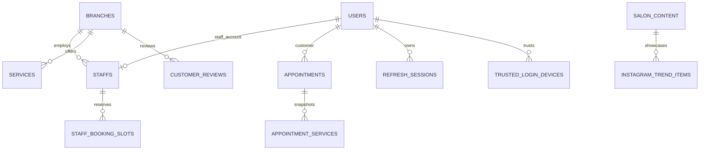

# DATABASE — MySQL, entities và quản lý schema

Source: `src/config/database.ts` và các entity tại `src/modules/**`. DB là **MySQL 8**; TypeORM `timezone: "Z"`. Production luôn `DB_SYNCHRONIZE=false`; `src/server.ts` chặn start nếu có migration mới chưa chạy.

## Sơ đồ quan hệ nghiệp vụ

Sơ đồ biểu đạt mối liên hệ **logic**; không phải mọi liên hệ đều có DB foreign key. Ví dụ lịch giữ snapshot nhân viên/khách và `appointment_services` chủ động dùng `createForeignKeyConstraints: false`.

## Entities chính

| Bảng | Khóa và trường quan trọng | Ý nghĩa |
|---|---|---|
| `users` | `id` UUID, unique nullable `email`, `phone`, `password_hash`, `role`, `token_version` | ADMIN/STAFF/CUSTOMER |
| `branches` | `id` int, `name`, `address`, `phone`, `opening_hours` | Chi nhánh |
| `staffs` | PK/FK `user_id`, `branch_id`, `work_start_time`, `work_end_time` | Mỗi nhân viên có ca làm lặp lại hằng ngày theo giờ Việt Nam; mặc định 09:00–20:30, có thể chỉnh trong Admin |
| `services` | `id` UUID, `branch_id`, `name`, `price`, `duration_minutes`, `booking_enabled`, category/description | Dịch vụ theo branch |
| `appointments` | `id`, `user_id`, `booking_group_id`, `party_size`, customer/staff/branch snapshots, `start_time`, `end_time`, actual times, `status` | Mỗi bản ghi dành cho một staff |
| `appointment_services` | PK (`appointment_id`, `service_id`), `service_name`, `price`, `duration_minutes` | Giá/dịch vụ tại thời điểm đặt |
| `staff_booking_slots` | **PK ghép** (`staff_id`, `slot_start`) | Chống đặt trùng ở độ phân giải 15 phút |
| `media_files` | `id` UUID, `original_name`, `mime_type`, `byte_size`, `created_by`, `created_at`, `image_data` MEDIUMBLOB | Ảnh lưu trực tiếp trong MySQL; danh sách chỉ đọc metadata |
| `offers` | `id`, `name`, `details`, `start_date`, `end_date`, `image`, `sort_order` | Khuyến mãi |
| `salon_content` | `id` int, tên/links/contacts/branding flags | Dữ liệu công khai của salon |
| `instagram_trend_items` | `salon_content_id`, `image_src`, `instagram_url`, `sort_order` | Trending images |
| `customer_reviews` | `branch_id`, `display_name`, `content`, `source`, `source_url`, `sort_order` | Đánh giá theo branch |
| `audit_logs` | `event_type`, `user_id`, `request_id`, identifier/IP/UA hashes, timestamps | Log bảo mật/requests |
| `refresh_sessions` | `user_id`, `family_id`, `token_hash`, `expires_at`, `revoked_at`, `replaced_by`, fingerprint | Refresh token rotation |
| `trusted_login_devices` | `user_id`, `token_hash`, `token_version`, role/UA hash, expiry/revocation | OTP trusted browser |
| `login_mfa_challenges` | `user_id`, `code_hash`, `attempts_remaining`, `expires_at`, `consumed_at` | OTP đăng nhập |
| `registration_email_challenges` | `email`, `code_hash`, số lượt/hạn dùng | OTP đăng ký |
| `password_reset_challenges` | `user_id`, code hash, số lượt/hạn dùng | Reset password |
| `password_change_challenges` | `user_id`, code hash, số lượt/hạn dùng | Change password |

## Index và sự nhất quán

- `appointments`: index `(user_id, start_time)`, `(staff_id, start_time)`, `booking_group_id`.
- `staff_booking_slots`: composite primary key `(staff_id, slot_start)` là cơ chế **atomic uniqueness** khi nhiều requests cùng chọn giờ; không thay thế bằng mutex ở frontend.
- `trusted_login_devices`: index `(user_id, expires_at)`, unique `token_hash`.
- `refresh_sessions`: index `(user_id, family_id)`, unique `token_hash`.
- `audit_logs`: composite indexes phục vụ rate limits/tra cứu hash và `request_id`.
- Các entities content có index theo parent và sort order.

**Lưu ý lịch nhóm:** API tạo `party_size` bản ghi `appointments`, mỗi staff có snapshot service riêng. Thống kê yêu cầu pending tối đa 3 dùng `COUNT(DISTINCT COALESCE(booking_group_id, id))`, không đếm trùng thành viên nhóm.

## Snapshot và delete

Lịch giữ `customer_full_name/phone/email`, `staff_full_name`, `branch_name/address` và snapshot service. Khi sửa/xóa user, staff, service hoặc branch, cần giữ semantics lịch sử theo service và schema đang triển khai. Admin `DELETE /api/appointments/:id` xóa thực một appointment và giải phóng slot. Trong khi đó, chuyển trạng thái sang `cancelled` giữ bản ghi lịch để phục vụ tra cứu lịch sử; hai thao tác có ngữ nghĩa dữ liệu khác nhau.

## Schema production và lịch sử migration

- MySQL production `nail_salon_db` đã được kiểm tra có **28 bảng** sau khi xóa `media_object_deletions` và cột `media_files.object_key`. 4 bản ghi ảnh vẫn có dữ liệu `image_data` tại thời điểm kiểm tra.
- Toàn bộ **30 file migration lịch sử đã được xóa khỏi source**; bảng TypeORM `migrations` trong production vẫn giữ lịch sử các migration đã chạy. Điều đó không tự làm thay đổi bảng/dữ liệu đang có.
- Hiện **không có baseline migration dựng database rỗng**. `npm run migration:run` trong phiên bản này không dựng được schema production mới; cần bản backup MySQL đã xác minh (gồm cả schema và dữ liệu) để phục hồi một môi trường tương đương. `DB_SYNCHRONIZE=true` chỉ dành cho local, không thay thế bản backup hoặc schema production.
- Railway API còn cấu hình pre-deploy `npm run migration:run`; khi source không có migration mới, bước này không tạo schema hoặc khôi phục dữ liệu. Nếu thay đổi cấu trúc trong tương lai, tạo migration mới được kiểm tra với schema hiện tại và backup trước khi áp dụng.
- Không xóa bảng `migrations` ở production chỉ vì đã dọn file lịch sử trong GitHub.

## Retention

Script `src/jobs/retention-cleanup.ts` dọn:

- `audit_logs` quá 90 ngày;
- `login_mfa_challenges` và `password_reset_challenges` quá 7 ngày; script **không** dọn `registration_email_challenges` hay `password_change_challenges`.
- `refresh_sessions`, `trusted_login_devices` hết hạn hoặc đã revoke quá 30 ngày.

Script retention có trong source nhưng repository không xác nhận Railway có scheduler đang chạy. Phải cấu hình/kiểm tra lịch chạy riêng trên Railway nếu cần; không được giả định nó tự hoạt động. Script không xóa dữ liệu booking/khách hàng.

Xem [BOOKING](BOOKING.md) để hiểu slot reservations và [DEPLOYMENT](DEPLOYMENT.md) để migrate/backup an toàn.
