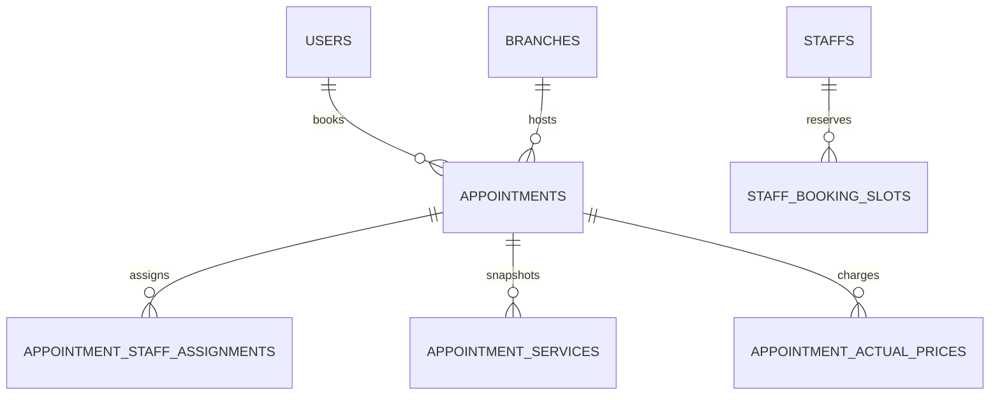

# Database model and schema management

The API uses MySQL and TypeORM. [database.ts](../src/config/database.ts) registers entities and migration paths and sets `timezone: "Z"`. Appointment timestamps use UTC; business-time calculations use Vietnam time.

## Booking relationships

This is a logical overview, not a claim that every relationship is an enforced database foreign key. The entity decorators define physical relationships; for example, service snapshots intentionally disable their appointment foreign-key constraint, while assignment and actual-price relations declare cascading appointment deletion.

## Entity groups

| Tables | Responsibility |
| --- | --- |
| `users`, `staffs`, `branches` | Accounts and roles, branch membership, recurring staff hours, branch opening hours |
| `services`, `service_categories` | Branch services, categories, display names, reference/range prices and bookable duration |
| `appointments` | One booking per customer submission, party size, reference ID, status, scheduled/actual times and customer/branch/primary-staff snapshots |
| `appointment_staff_assignments` | Primary guest positions, optional service helpers, reserved helper interval and individual start/completion timestamps |
| `appointment_services` | Service name, price and duration snapshots; zero-duration rows represent additional custom work |
| `appointment_actual_prices` | Actual charge owned by an employee for a service on an appointment |
| `staff_booking_slots` | Physical 15-minute staff reservations |
| `staff_assignment_rotation` | Per-branch cursor used for allocation locking and rotation |
| `appointment_transfer_requests` | Sender/recipient, request status, scheduled-time snapshot, logical hold and expiry |
| `walk_in_visits`, `walk_in_visit_services` | Separate walk-in identity, employee/branch snapshots and reference/actual service prices |
| `notification_outbox` | Persisted booking email, claim status, attempts and retry scheduling |
| `offers`, `salon_content`, `instagram_trend_items`, `customer_reviews` | Promotions and public website content |
| `media_files` | Image metadata and `MEDIUMBLOB` bytes |
| `website_visits` | Browser-tab visit sessions and first/last activity timestamps |
| `audit_logs` | Request/security events and relevant hashed identifiers |
| `refresh_sessions`, `trusted_login_devices` | Hashed proofs, session families, expiry and revocation |
| `login_mfa_challenges`, `registration_email_challenges`, `password_reset_challenges`, `password_change_challenges` | Single-use email verification challenges |

## Keys and ownership

- `staff_booking_slots`: primary key `(staff_id, slot_start)` protects physical reservation uniqueness.
- `appointment_staff_assignments`: primary key `(appointment_id, staff_id)`; `position` identifies a guest. `assisted_service_id IS NULL` denotes a primary worker; a helper shares the guest position and names one delegated service.
- `appointment_services`: primary key `(appointment_id, service_id)`; snapshots are shared at the appointment level, not duplicated for each guest.
- `appointment_actual_prices`: primary key `(appointment_id, staff_id, service_id)`; price ownership follows the employee's assigned services.
- `appointments`: indexes include `(user_id, start_time)`, `(staff_id, start_time)` and `booking_group_id`. Assignment joins provide multi-worker lookup; the appointment's `staff_id` is only the primary compatibility field.
- Transfer-request indexes support target/status/expiry and appointment/status lookup. Active logical holds must be considered alongside physical slots.

`booking_group_id` remains a customer-reference identifier. New group bookings create one appointment with multiple assignments. Normal queries exclude rows with `merged_into_id` set; the pending limit counts distinct `COALESCE(booking_group_id, id)` for compatibility with older records.

## Snapshots and monetary values

Booking records preserve customer, branch and employee names and service reference prices/durations. Catalog changes do not automatically rewrite these snapshots. An explicit admin service/schedule edit may replace snapshots and rebuild assignments under the booking rules.

The initial reference charge is `party_size * sum(booked service prices)`. Actual-price rows replace the corresponding guest/service reference; additional work adds its recorded charge. Missing entries use the booked price, while zero is a valid explicit charge. Helpers must not multiply guest charges.

See [charge calculation](../src/modules/appointments/appointment-charge.ts), [work-price service](../src/modules/appointments/booking-work.service.ts) and [Booking](BOOKING.md).

## Media and operational data

`media_files.image_data` is a `MEDIUMBLOB` excluded from normal entity selection. List requests read metadata; individual file requests explicitly select bytes. Offer/trend references use URLs rather than foreign keys. See [Media storage](MEDIA-STORAGE.md).

Visit statistics count browser-tab session IDs, not page views or distinct people. Security retention is handled separately from appointment and walk-in history.

## Schema provisioning and migrations

Production forces `synchronize=false` and `logging=false`. The server checks for pending migrations before listening. Development may synchronize entity tables, but this is not a versioned production provisioning strategy and does not seed business data.

Two incremental migrations are included:

| Migration | Purpose and prerequisite |
| --- | --- |
| `EnableServiceAssistance1792560000000` | Adds assistance columns to an existing `appointment_staff_assignments` table; its down migration removes those columns |
| `SetNailServiceDurations1792560000001` | Fills missing durations for exact named services in branch 1; preserves existing durations and booking visibility; its down method deliberately preserves those values |

These are not a complete schema baseline. They assume existing tables and cannot initialize a production-equivalent database from an empty MySQL instance. The repository also has no seed command for initial accounts/catalog content. A new environment needs a compatible, reviewed schema/data provisioning process or an authorized sanitized snapshot.

Compile the backend before running the migration scripts, which load `dist/config/database.js`. Keep applied migration history intact, inspect schema compatibility and back up the target database before applying changes. Entity registration is not evidence of the table count or migration status of a deployed database.

## Retention

The separate cleanup job deletes old audit events, all four expired/consumed challenge types, expired/revoked refresh and trusted-device records, and old sent outbox messages. It preserves queued messages and does not purge booking history. Scheduling and exact thresholds are documented in [Operations](OPERATIONS.md).
